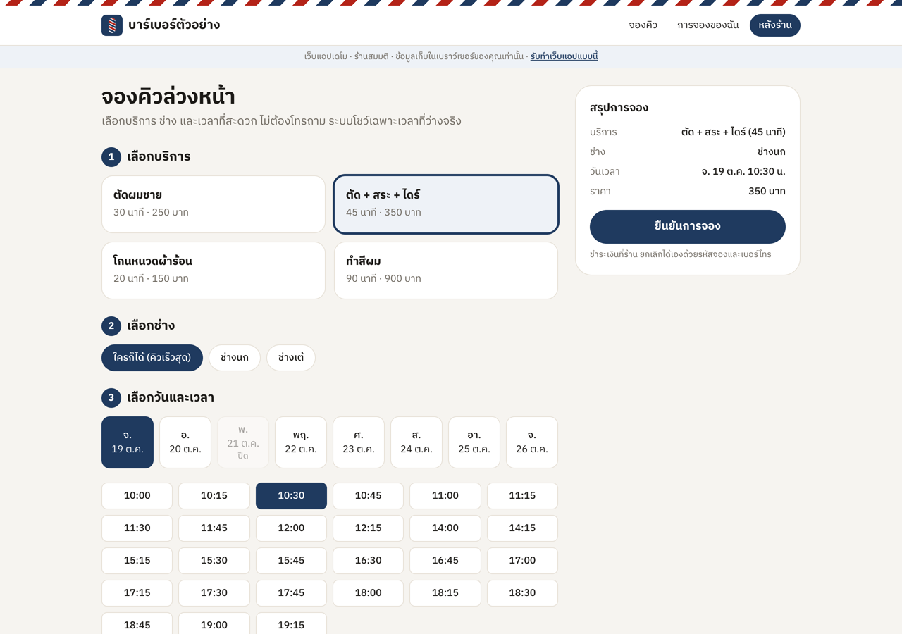
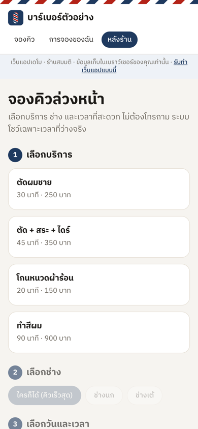
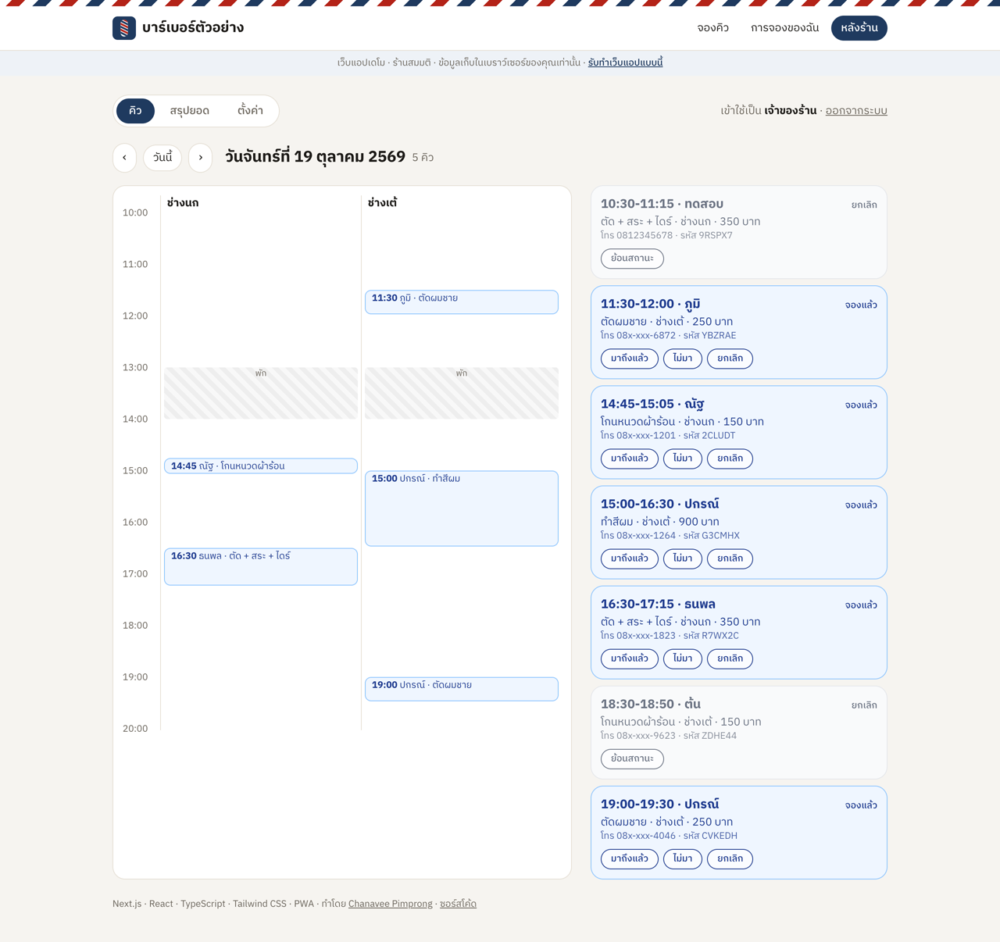

# จองคิว · เว็บแอปจองคิวร้าน (เดโม)

**ลองใช้: https://jongkiew.vercel.app** · ร้านสมมติ "บาร์เบอร์ตัวอย่าง" · ข้อมูลเก็บในเบราว์เซอร์ของผู้ใช้แต่ละคน

เว็บแอปจองคิวสำหรับร้านที่รับลูกค้าแบบนัดเวลา (ร้านตัดผม สปา คลินิก ร้านซ่อม) ลูกค้าจองเองได้ตลอด 24 ชั่วโมง
เห็นเฉพาะเวลาที่ว่างจริง ส่วนร้านดูคิววันนี้เป็นตารางเวลา เช็กอินลูกค้า ดูสรุปยอด และดาวน์โหลดเป็น Excel ได้



## ฝั่งลูกค้า

- เลือกบริการ → ช่าง (หรือ "ใครก็ได้" ระบบเลือกช่างที่ว่างและคิวน้อยที่สุด) → วัน → เวลาที่ว่างจริง → ชื่อ / เบอร์โทร
- ระบบคิดเวลาจากความยาวของบริการ ช่วงพักเที่ยง วันหยุดร้าน คิวที่มีอยู่แล้ว และไม่ให้จองเวลาที่ผ่านไปแล้วหรือกระชั้นเกิน 30 นาที
- ตรวจซ้ำตอนกดยืนยัน ถ้ามีคนจองเวลาเดียวกันตัดหน้า ระบบให้เลือกใหม่
- ได้รหัสจอง 6 ตัวอักษร (ไม่มี 0/O 1/I ที่อ่านสับสน) และปุ่ม **เพิ่มลงปฏิทิน** (.ics)
- **การจองของฉัน:** ใส่รหัสจอง + เบอร์โทร ดูหรือยกเลิกได้เองจนถึง 1 ชั่วโมงก่อนนัด



## ฝั่งร้าน (หลังร้าน)

| บทบาท | ทำอะไรได้ |
|-------|-----------|
| พนักงาน | ดูคิวเป็นตารางเวลาแยกช่าง, เช็กอินลูกค้า (มาถึงแล้ว → เสร็จแล้ว), บันทึกไม่มาตามนัด, ยกเลิก |
| เจ้าของร้าน | ทุกอย่างของพนักงาน + สรุปยอด 7 วัน (จำนวนคิว รายได้ อัตราไม่มา บริการยอดนิยม กราฟรายวัน), ดาวน์โหลด Excel (CSV ภาษาไทยไม่เพี้ยน), แก้ราคา / เวลาบริการ / เวลาเปิดร้าน |



ติดตั้งเป็นแอปบนมือถือได้ (PWA: manifest + service worker เปิดแอปได้แม้เน็ตหลุด)

## เดโมนี้ต่างจากงานจริงอย่างไร

| เดโม | งานจริง |
|------|---------|
| ข้อมูลเก็บใน `localStorage` ของแต่ละเบราว์เซอร์ ([`src/lib/store.ts`](src/lib/store.ts)) | ฐานข้อมูล Supabase (PostgreSQL) พร้อม Row Level Security แยกสิทธิ์ลูกค้า / พนักงาน / เจ้าของ |
| เลือกบทบาทจากปุ่ม | ล็อกอินด้วยอีเมลหรือ LINE |
| โชว์ข้อความแจ้งเตือนที่ร้านจะได้รับ | ส่งเข้า LINE ของร้านจริงผ่าน LINE Messaging API และเตือนลูกค้าก่อนนัด |

กติกาการจองทั้งหมดอยู่ใน [`src/lib/booking.ts`](src/lib/booking.ts) ไม่ผูกกับหน้าเว็บหรือฐานข้อมูล ย้ายไปใช้กับ Supabase ได้โดยไม่ต้องเขียนใหม่

## รันบนเครื่อง

```bash
npm install
npm test          # กติกาการจอง: ช่วงพัก วันหยุด คิวชน เวลาที่ผ่านไปแล้ว เลือกช่าง รหัส เบอร์โทร สรุปยอด CSV / ICS
npm run dev       # http://localhost:3000
npm run build && npm run lint
```

Next.js 16 · React 19 · TypeScript · Tailwind CSS 4 · Vercel

---

ทำโดย [Chanavee Pimprong](https://chanavee.vercel.app) · [รับทำเว็บแอป ระบบจองคิว ระบบสมาชิก Dashboard บน Fastwork](https://fastwork.co/user/chasvitf/web-development-26274679) · MIT License
